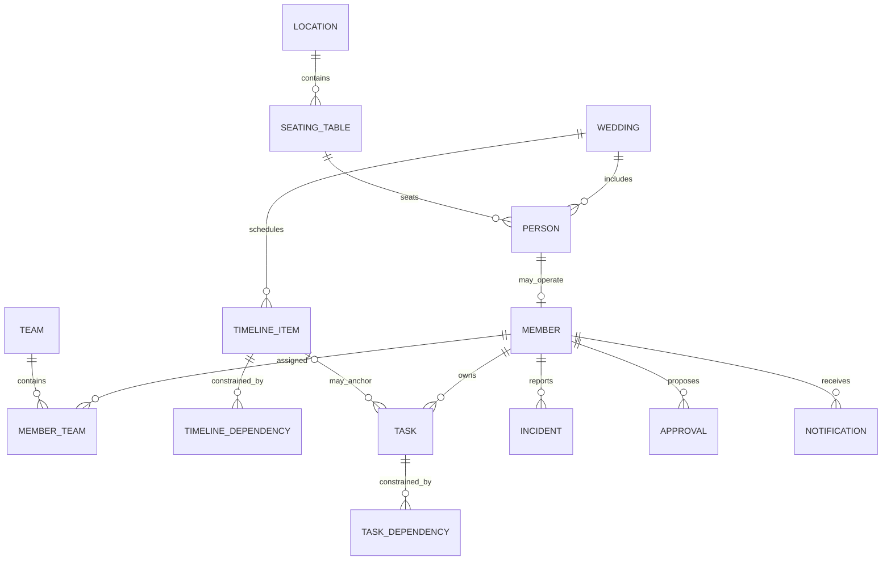

# Data model and invariants

The executable schema is `src/wedding_ops/models.py`; the initial frozen migration is `migrations/versions/0001_initial.py`. `docs/contracts/` contains OpenAPI, command, intent and permission JSON generated from code. There are 24 database tables in this foundation.

## Identity is not attendance

`Person` represents a real event participant. A person may be a guest, a helper, a family contact, or several at once. `Member` grants authenticated application access to that person; `MemberTeam` defines scope. Reusing an existing guest when creating a member prevents duplicate people. Roles are a constrained application registry stored on the membership, not an LLM-inferred persona. Telegram sender identity binds to a membership, not a display name.

`Person.attendance` has unknown/onsite/departed states and an explicit arrival timestamp. Unknown does not mean absent. Family-location incidents can coexist with an earlier onsite check-in. A coordinator can edit the guest's relationship and private contact through a version-checked editor. Parent shortcuts resolve exact normalized roles such as `father_of_bride`; other family roles use exact names and must not be mistaken for parents.

Private phone and dietary fields are intentionally excluded from generic snapshots/search. Dietary service notes require banquet/coordinator access. Family contacts require the family-liaison/coordinator grant and a designated family relationship. Detailed guest editing is coordinator-only; sensitive access adds metadata-only audit records.

## Operational graph

The diagram is conceptual, not a substitute for the SQL constraints. Each event-scoped entity/reference carries `wedding_id`; cross-wedding identifiers fail lookup or composite foreign-key validation. Task/run-sheet graphs are acyclic by construction and dependency validation. Existing record edit/reorder APIs are deliberately limited rather than providing arbitrary graph mutation.

## Table groups

| Group | Tables | Meaning |
|---|---|---|
| Cell | weddings | Name, date, IANA timezone, venue, lifecycle, state/timeline versions |
| Roster | people, members, teams, member_teams | Guest/family fields, application access, roles and scope |
| Venue | locations, seating_tables, vendors | Directions/schematic coordinates, table capacities, scoped business contacts/status |
| Execution | timeline_items, timeline_dependencies, tasks, task_dependencies | Planned/current/actual timing, hard stops, owners and explicit prerequisites |
| Control | incidents, approvals, action_drafts | Reported exceptions, exact reviewed changes, short-lived human confirmation |
| Knowledge/import | knowledge_documents, guest_imports | Approved text provenance/audience and previewed guest batches |
| Delivery | notifications, inbound_updates | Durable outbound/inbound work, leases, retry state and provider IDs |
| Audit | audit_events, command_receipts | Attributable transitions and idempotency results; not arbitrary PII copies |
| Access | invitations, login_sessions, auth_replays | Hashed one-use tokens, CSRF/session hashes and Mini App replay prevention |

## State transitions

Wedding: draft → live → archived. Live can return to draft to pause reminder generation; archived is read-only except acknowledgement/revocation. Unarchive is intentionally not available through the interface.

Task: pending → in_progress → done, with independent acknowledgement. A task can be completed from pending after prerequisites are done; the code does not demand a ceremonial intermediate transition. Closed/cancelled tasks reject new actions. Cancellation creation/edit workflows are not exposed yet.

Timeline: scheduled → live → complete, with actual timestamps recorded by a coordinator. Delay proposals apply only to scheduled activities. Versions prevent stale decisions.

Approval: pending → approved/rejected/expired. A stale pending proposal remains visible but cannot be approved. Every new material timeline change requires a fresh proposal. There is no autonomous approval path.

Knowledge: draft → approved → retired. Audience is explicit. Current creation uses revision 1 for separate documents; an in-place versioned replacement workflow is not implemented.

Delivery: queued → sending → sent/simulated, retry to queued, or failed/undeliverable/cancelled/superseded. Human acknowledgement is a timestamp independent of delivery status.

## Time, concurrency and lifecycle

Persist datetimes as UTC-aware values, render using the wedding's IANA timezone, require offsets on API timestamps and test UTC round trips. DemoClock changes only rehearsal operational time; access-token expiry always uses actual UTC. Do not copy the demonstration timestamp into a real deployment.

Every business write locks the cell and revalidates access. Guest/task row versions guard stale editors; timeline proposals additionally bind to the exact timeline version. Import previews bind to the state version and can become stale even after unrelated operational updates; bulk ingest is therefore a pre-event workflow.

Each deployed cell currently uses its own database. Application scopes and composite keys do not replace host/network isolation or database least-privilege credentials. Archive does not erase data. Backup/retention/deletion are explicit operator procedures pending a reviewed lifecycle service.
