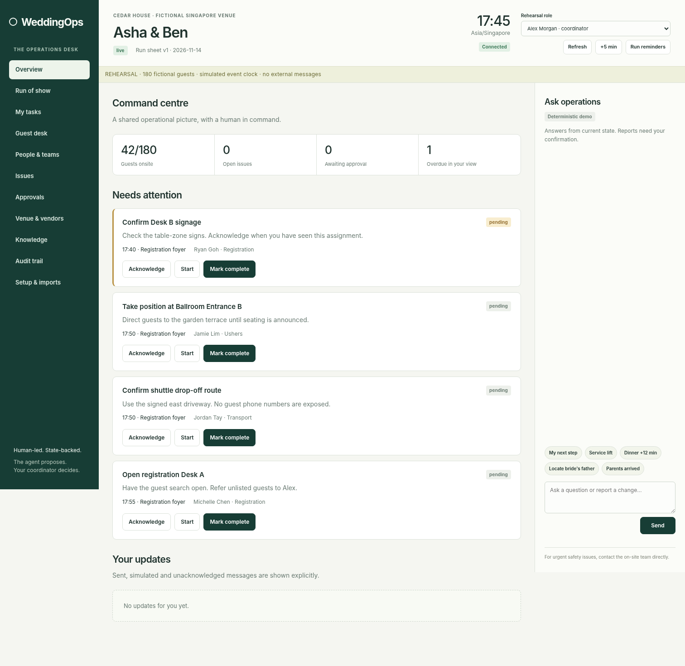

# LoveOnCue

**A working, human-led wedding-day operations foundation.** Role-aware helpers, a live run sheet, guarded reports and approvals, and targeted updates. This is a tested local rehearsal build, **not a production-certified wedding coordinator**.



## Run the rehearsal

From a source checkout, with Python 3.12+ (tested on 3.13):

```bash
python3 -m venv .venv
source .venv/bin/activate
python -m pip install -r requirements-runtime.lock -e .
python scripts/dev.py
```

Open **http://127.0.0.1:8000**. On Windows, activate with `.venv\Scripts\Activate.ps1` and use `python` instead of `python3`. Browser assets are already compiled; Node is only needed to edit/rebuild the UI. Package installation requires network access or a populated package cache.

No model credentials, Telegram token, PostgreSQL, Docker or new account is required for this fictional rehearsal. The clock starts at 17:45 Singapore time on the fictional event day, 14 November 2026. The demo binds loopback and cannot send external notifications. Do not tunnel it onto the public internet.

Choose **Alex Morgan · coordinator**. Inspect the 180 guests, 18 tables, 11 operator memberships, teams, tasks, vendors and reference documents. The rehearsal role picker is demo-only and does not exist in production.

### Demonstrate the actual vertical slice

1. Switch to **banquet**. Ask “Dinner needs another 12 minutes.” Confirm the interpretation. A proposal exists, but the run sheet has not changed.
2. Switch to **coordinator**, open Approvals, review the exact changes and approve. Dinner moves 12 minutes; downstream gaps absorb some delay. The run sheet version increments and relevant team updates enter the durable outbox.
3. Switch to **photographer**, report “Bride's father isn't here yet,” and confirm. Switch to **registration-a**, report “Bride's parents just arrived,” and confirm. The matching incident resolves; photography/family coordination receive notices, not unrelated ushers.
4. As registration, search **Sarah Tan**: Table 18. As usher, ask **/knowledge service lift**. Private dietary notes and family phone numbers are not returned to an usher.
5. In coordinator mode, run reminders and advance the rehearsal clock. Inspect overdue assignments, delivery states and acknowledgements. Simulated delivery is visibly labeled; it is not a Telegram receipt.

Reset only this fictional local database with `python scripts/dev.py --reset`. The reset command refuses a database containing a non-demo wedding.

## What is implemented

- Same-origin responsive web interface: command centre, run sheet, tasks, guest desk, people/teams, issues, approvals, venue/vendors, knowledge, audit and setup/imports.
- Typed Python API and normalized database models. Atomic commands, optimistic versions, per-wedding transaction locks, idempotency receipts, audit records and durable notifications.
- Coordinator-issued one-use invitations, revocable memberships, role/team permissions, private Telegram identity binding and Mini App signature validation.
- CSV guest preview/import; guarded guest corrections, seating-capacity checks, family roster/contact access and dual guest/helper identity. Team, person, location, table, task, vendor and run-sheet creation.
- Conservative dependency-aware delay proposals, expiry/staleness checks, hard-deadline blockers and explicit coordinator approval. Actual activity starts/finishes require human confirmation.
- Approved, team-scoped text knowledge with source/revision/line references; no model-generated “facts” replacing the database.
- Telegram ingress/outbox adapters, deterministic reminders/retries/escalations, and an optional direct Mistral intent adapter. Local integration tests use controlled transports, not live credentials.

## Deliberate architecture

**FastAPI + Pydantic + SQLAlchemy/Alembic; TypeScript browser UI; PostgreSQL for deployment; SQLite for the demo.** The original Next.js/Prisma suggestion was not a requirement. A functioning, tested stack was preferable to an unverified framework scaffold in this build environment. See [ADR 0002](docs/adr/0002-stack-and-database.md).

The application owns Telegram, operational state, permissions, and approvals. Explicit commands run locally. When enabled, Mistral interprets one free-form message per request and returns a typed intent. See [agent design](AGENT_DESIGN.md) and [provider commissioning](deploy/README.md#mistral-commissioning).

## Telegram rehearsal

In Telegram, helpers can open their tasks or find a guest if their role permits
it. Coordinators can open the summary with `/brief` or the expanded view with
`/brief_more`. Confirm a report with its button or the supplied `/confirm`
command. A schedule proposal still requires approval in the coordinator app.

To exercise multiple fictional roles locally:

```bash
python scripts/rehearse-telegram.py \
  --as coordinator /brief \
  --as banquet /brief \
  --as registration-a '/guest Sarah Tan'
```

The rehearsal starts with a fresh fixture database and produces local replies.
The [recovery notes](docs/plans/2026-11-21-loveoncue-telegram-recovery.md) record
which October behaviors were kept. Setup photo analysis is read-only and
optional. See the [Telegram deployment notes](deploy/README.md#telegram-commissioning).

## Verify and develop

```bash
pip install -r requirements-dev.txt
pytest --cov=wedding_ops --cov-branch
npm ci --ignore-scripts
npm run typecheck
npm run build
python scripts/export-contracts.py
```

Browser tests: install `requirements-browser.txt`, run `playwright install chromium`, start the local demo and run `python scripts/ui-smoke.py`. The optional `--bridge` mode verifies UI interaction against the real API in an offline test bridge; it is explicitly not a browser networking test. See [TESTING.md](TESTING.md) and its verification record.

## Start here with Codex

Read **[HANDOFF.md](HANDOFF.md)** and **[AGENTS.md](AGENTS.md)**. Then use [ARCHITECTURE.md](ARCHITECTURE.md), [DATA_MODEL.md](DATA_MODEL.md), [AGENT_DESIGN.md](AGENT_DESIGN.md), [SECURITY.md](SECURITY.md), [THREAT_MODEL.md](THREAT_MODEL.md), [PRODUCT.md](PRODUCT.md), [RESEARCH.md](RESEARCH.md), [ROADMAP.md](ROADMAP.md) and [deploy/README.md](deploy/README.md).

CI exercises PostgreSQL, the core suite, and the browser workflow. The deployment runbook covers the separate live checks for TLS, Telegram, and Mistral. A supervised pilot requires the remaining gates in [docs/PILOT_RUNBOOK.md](docs/PILOT_RUNBOOK.md).

## Source and license

The original release bundle and source ZIP are described in [docs/PERSISTENCE.md](docs/PERSISTENCE.md).

WeddingOps is independently written. All rights are reserved. See [LICENSE](LICENSE) and [THIRD_PARTY_NOTICES.md](THIRD_PARTY_NOTICES.md).
